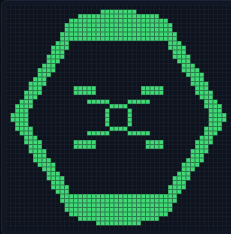

# Conway's Game of Life — drop-in canvas module

A small, dependency-free Game of Life you can include in any web page. No build
step, no framework, no external assets. It renders to a canvas, loads patterns
from plaintext or RLE files, and supports click/drag drawing.



## License

Copyright (C) 2026 [Toyoko LLC](https://www.toyoko.io/). Licensed under the **GNU General Public
License, version 3 or (at your option) any later version** (GPL-3.0-or-later).
See [LICENSE](LICENSE) for the full text, or <https://www.gnu.org/licenses/>.

SPDX-License-Identifier: `GPL-3.0-or-later`

## Files

| File | Purpose |
| --- | --- |
| `game-of-life.js` | The module. This is the only file you need to copy. |
| `index.html` | Sample page with controls, file loading, and drag-and-drop. |
| `patterns/glider.txt` | Initial pattern used by the sample (plaintext format). |
| `patterns/dnalinux.txt` | The DNA Linux logo rasterised to 50×50 (a 48×48 logo area with a one-cell dead border). |
| `assets/screenshot.png` | Screenshot of the sample page, shown above. |

## Run the sample

From this folder:

```sh
python3 -m http.server 8000
```

Then open <http://localhost:8000>.

A local server is required: browsers block ES module imports (and `fetch()`) on
`file://` pages, so double-clicking `index.html` will not start the simulation.
The page shows a reminder if that happens. Any static server works.

## Include it in your page

```html
<div id="life"></div>

<script type="module">
  import { GameOfLife } from './game-of-life.js';

  const life = new GameOfLife('#life', {
    cols: 50,
    rows: 50,
    cellSize: 10,
  });

  await life.loadPatternFromURL('patterns/glider.txt');
  life.start();
</script>
```

`game-of-life.js` is an ES module, so the script tag needs `type="module"` and
the page must be served over HTTP (or by a bundler/dev server) — not opened from
the filesystem. The canvas is responsive by default: it shrinks to fit its
container but never grows past `cols * cellSize` pixels.

## Options

| Option | Default | Description |
| --- | --- | --- |
| `cols` | `50` | Grid width in cells. |
| `rows` | `50` | Grid height in cells. |
| `cellSize` | `10` | Cell size in CSS pixels. |
| `speed` | `120` | Milliseconds between generations. |
| `wrap` | `false` | `true` makes the edges toroidal (wrap around). |
| `interactive` | `true` | Click and drag to toggle cells. |
| `responsive` | `true` | Scale the canvas down to fit its container. |
| `background` | `'#0b1220'` | Canvas background. |
| `cellColor` | `'#4ade80'` | Live-cell color. |
| `gridColor` | `'rgba(148, 163, 184, 0.14)'` | Grid line color (`null` hides lines). |
| `onUpdate` | `null` | Called with `{ generation, population, running, cols, rows }` after every change. |

## API

```js
const life = new GameOfLife(container, options);
```

`container` is an element or a CSS selector. The module creates and appends a
`<canvas class="life-canvas">`.

### Playback

| Method | Description |
| --- | --- |
| `start()` | Start advancing generations. |
| `pause()` | Stop advancing; state is kept. |
| `toggle()` | Start if paused, pause if running. |
| `step()` | Advance exactly one generation. |
| `setSpeed(ms)` | Milliseconds per generation (clamped to 16–5000). |
| `setWrap(bool)` | Toggle toroidal edges. |
| `running` | Read-only getter: `true` while playing. |
| `stats()` | Returns `{ generation, population, running, cols, rows }`. |

### Grid and patterns

| Method | Description |
| --- | --- |
| `loadPattern(input, { center, x, y })` | Replace the grid with a pattern. Accepts pattern text or a `{ width, height, data }` object. Centered by default; pass `x`/`y` for a fixed origin. Returns the parsed pattern. |
| `loadPatternFromURL(url)` | `fetch()` a pattern file, then load it. Returns a promise. |
| `placePattern(input, x, y)` | Add a pattern to the grid without clearing it. |
| `clear()` | Remove all cells and reset the generation counter. |
| `randomize(density = 0.3)` | Fill randomly. |
| `getCell(x, y)` | `true` if alive. |
| `setCell(x, y, alive)` | Set one cell and redraw. |
| `toggleCell(x, y)` | Flip one cell and redraw. |
| `destroy()` | Pause, remove listeners, and remove the canvas. |

Also exported: `parsePattern(text)`, which returns
`{ width, height, data: Uint8Array }` and throws on invalid input.

### Example: custom styling

The canvas has the class `life-canvas`, so style it from CSS:

```css
#life canvas {
  border-radius: 10px;
  box-shadow: 0 10px 30px rgba(0, 0, 0, 0.4);
}
```

## Pattern files

The module reads the two common Life formats. Only the standard B3/S23 rules
are used; a `rule = ...` header is accepted but ignored.

### Plaintext (`.cells`)

- `O` = alive (`.` also accepted as dead; `*` and `1` count as alive)
- `.` = dead
- Lines starting with `!` are comments
- Rows may have different lengths; missing cells on the right are dead
- Any size is fine: the pattern is centered on the grid, and cells that fall
  outside are clipped (a warning is logged)

```text
!Name: Glider
!Author: Richard K. Guy
.O.
..O
OOO
```

### RLE

A line starting with `x = ...` marks an RLE pattern. `b` = dead, `o` = alive,
`$` = end of row, `!` = end of pattern, and a leading number is a repeat count.
Lines starting with `#` are comments.

```text
#N Glider
x = 3, y = 3, rule = B3/S23
bo$2bo$3o!
```

You can load a file at runtime with `loadPatternFromURL('my-pattern.rle')`, or
let users pick/drop one as the sample page does (`life.loadPattern(await
file.text())`).

## Notes

- The simulation uses two `Uint8Array` buffers; a step is O(cells) with no
  allocations, so even much larger grids are cheap.
- `requestAnimationFrame` drives the clock; generation timing adapts if the
  page is busy or backgrounded rather than piling up a backlog.
- Multiple independent instances can coexist on one page.
